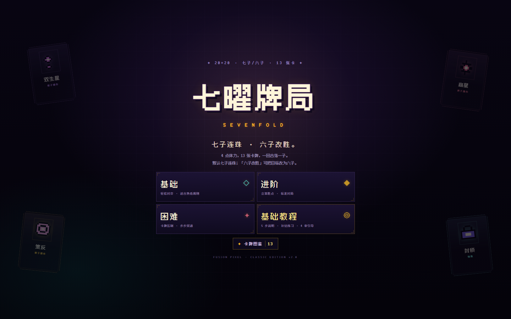
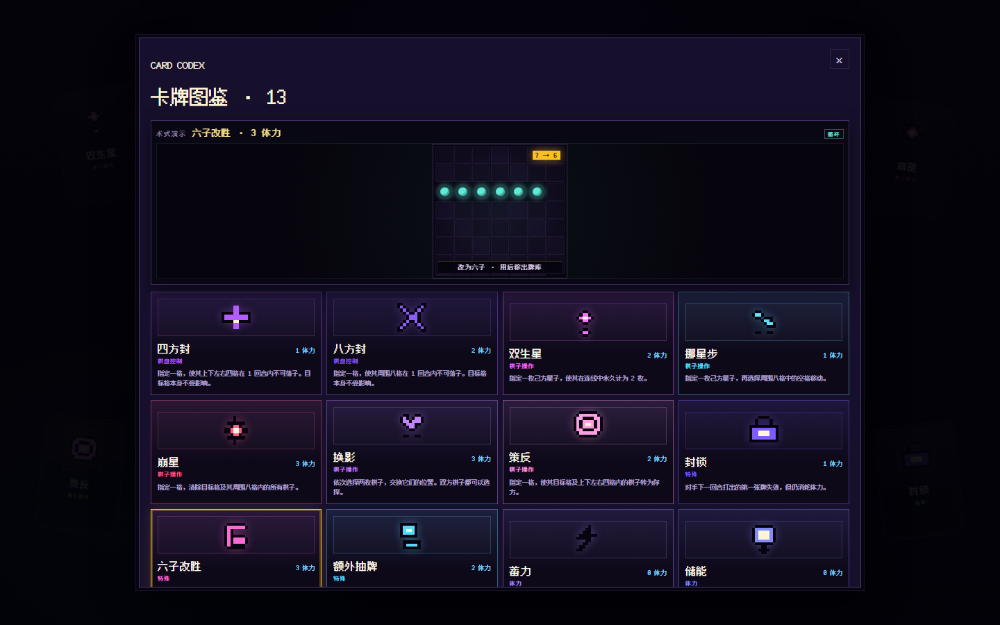
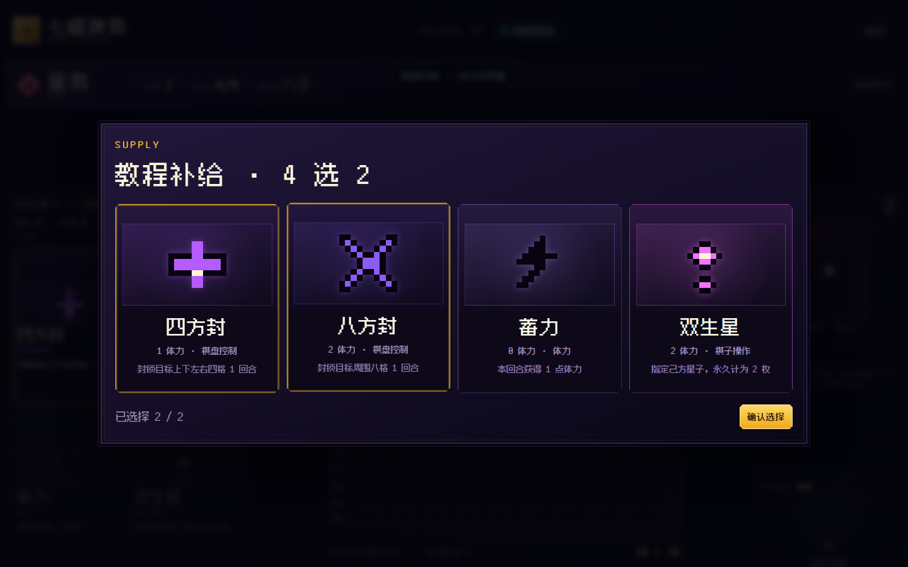
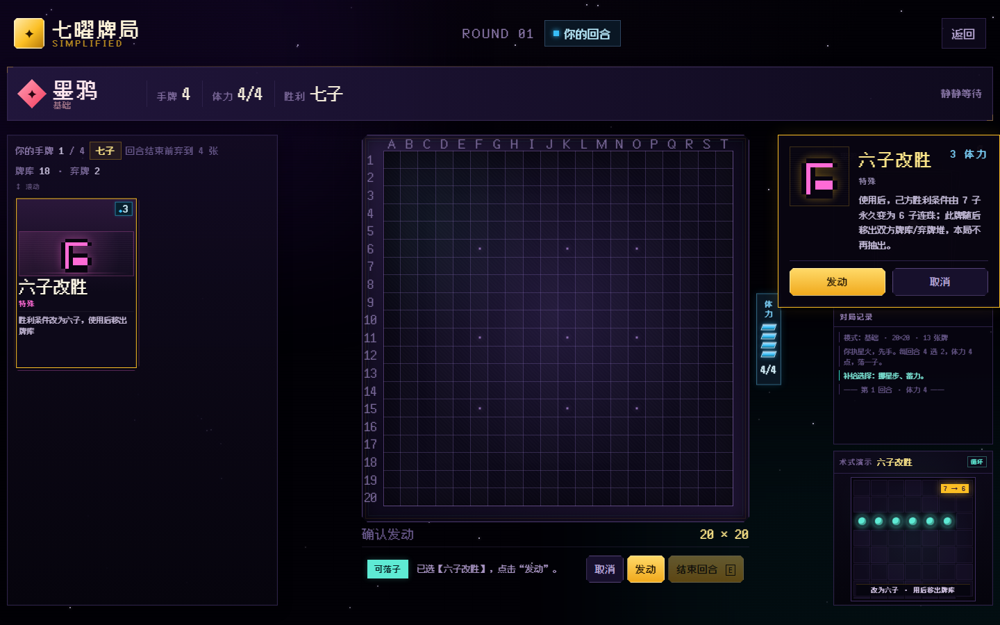

# 七曜牌局 · 简化版 v1.1

20×20 七子棋 + 13 张卡牌的像素风网页游戏，支持人机对局、Boss 关与 LLM 对战。

## 共同开发

本项目由以下五人共同开发，**排名不分先后**：

- 桃派
- 三千梨花树
- Chastity57
- TauQ1u
- a65990986-lgtm

## 版本新增（v1.0.6 → v1.1）

### 图标
`pictures/Pasted image.png`（紫底金边像素棋盘）已转成 `assets/favicon-32.png`、`assets/favicon-192.png`、`assets/apple-touch-icon.png`，
`index.html` 里三档都挂了；浏览器标签页、iOS 主屏图标、顶栏左上角的品牌图标都用它（右侧「七曜牌局 / SIMPLIFIED」文字保留）。

### 标题页
- 主体是「基础 / 进阶 / 困难 / 新手教程」四个大方块；
- **Boss / 挑战 LLM / LLM 对战**收进下方一行小按钮，不和主体混在一起；
- 删掉了原来那段「4 点体力，13 张卡牌……」的说明文字；
- 「基础教程」统一改叫「新手教程」；
- 「卡牌图鉴」和「LLM 设置」并排一行。

### 难度立绘
四档各有一张背景立绘，鼠标悬停模式按钮时在标题屏预览，开局后固定：

| 模式 | 背景 |
| --- | --- |
| 基础 | `assets/bg/easy.webp` |
| 进阶 | `assets/bg/middle.webp` |
| 困难 | `assets/bg/hard.webp` |
| Boss | `assets/bg/boss.webp` |

「墨鸦手牌」最上面那张牌也用当局限定立绘做卡背。

### Boss 关（两条命 + 换营）
标题页多了 **Boss** 模式，墨鸦有 **2 条命**：

- 你第一次凑出 7 子（用【六子改胜】后是 6 子）时，**只拆掉这条连珠上的棋子**，墨鸦掉 1 条命，对局继续；
- 第二次凑出来才算**完全胜利**；
- **换营**：你每第 2、4、6… 次连成 5 子（同一方向的一条连段算一次），双方棋盘上的星子归属互换；
  但如果墨鸦此时**势力分占优**，换营不发动；
- 换营只动棋盘上的子：手牌、牌库、胜利条件、封禁格都不动；换完如果墨鸦因此连成 7 子，当场判负。

Boss 立绘：`assets/boss-card.png`（模式按钮缩略图）、`assets/boss-face.png`（对局里墨鸦的头像）。

### LLM 对战（不内置本地 AI）
标题页多了两个入口，都要**自己填接口和密钥**：

- **挑战 LLM**：你执星火，对面坐一个云端模型；
- **LLM 对战**：两个模型互搏，你只看。

点标题页的 **LLM 设置** 填：服务商 / Base URL / 模型名 / API Key（可选“思考模式”）。
配置只存在浏览器 `localStorage` 里，不会上传。任何 OpenAI 兼容端点都能用。

> 浏览器直连要服务商返回 CORS 头：DeepSeek / MiniMax / 小米可用；智谱（bigmodel.cn）不返回，
> 直连会被浏览器拦掉，需要自建代理。

模型每回合只输出一个 JSON：`{"why","place","cards","discard"}`，`place` 是“编号落点”里的序号；
输出不合法会自动带着错误提示重问一次，仍然不合法就弹出“LLM 掉线”面板（重试 / 结束对局），
**不会偷偷退回本地 AI**。

### 对战音乐
`promo/audio/chip-battle_1-5s.mp3` 做了无缝循环（尾部 80ms 交叉淡化）→ `assets/audio/bgm/battle-loop.mp3`，
开局自动播放、结算淡出；顶栏新增「♪ 音乐」开关（记在 localStorage）。

### 玩法与规则（沿用 v1.0.x）
规则延续《棋类+卡牌游戏开发 (2)》，并按 (3) 保留新手教程与敌方逐条反馈：**4 体力、起手 4 张、每回合 4 选 2（开局也进行）、手牌上限 4、13 张即时术式**。
界面沿用深紫 / 金色 / 青色 / 珊瑚红像素风：**左侧手牌（两列、可上下滚动）、中央放大棋盘（左右留白一致）、右侧对手牌堆 + 对局记录 + 术式演示**。



## 运行

无需构建、无需服务器：

1. 双击 `index.html`，用 Chrome / Edge / Firefox 打开。
2. 或在本目录运行：

```bash
python -m http.server 8000
```

然后访问 `http://localhost:8000`。

字体与资源全部在本地，断网也可运行。

## 入口与图鉴

标题页保留四个模式入口，并新增「卡牌图鉴」按钮：

| 入口 | 说明 |
| --- | --- |
| **基础** | 轻松 AI，适合熟悉规则 |
| **进阶** | 标准 AI，会计算胜点 |
| **困难** | 更积极用牌、更强压制 |
| **基础教程** | 先讲获胜条件 + 5 步界面说明 + 补给练习 + 4 章引导对局 |
| **卡牌图鉴** | 首页按钮，查看 13 张卡；选中卡牌在上方循环播放效果演示 |



## 核心规则

- 在 **20×20** 棋盘上率先完成 **7 子连珠**（横、竖、斜）即获胜；“六子改胜”使用后改为 **6 子**。
- 双方起手各抽 **4 张**；**开局也立即进行 4 选 2**，选完手牌为 6 张。
- 每回合开始：系统给出 **4 张不重复的补给**，玩家选择 **2 张**加入手牌，剩下 2 张进弃牌堆。
- 崩星/策反都包含选中的中心格；棋盘下方“可落子”为青色，“已落子”为黄色。
- **体力上限 4**；打牌消耗体力，体力不足不能出牌。回合结束时多余的体力不会留到下一回合，但体力在每回合开始时都会自动补满。
- 一回合可以打任意张牌，但**只能落一子**；落子后仍可继续出牌。
- 回合结束时若手牌超过 4 张，**必须弃到 4 张**；未落子不能结束回合。
- 卡牌全部为即时术式，没有暗牌 / 延迟触发。
- 玩家补给后手牌会到 6 张，因此开局第一回合结束前就要弃到 4 张。

## 13 张卡牌

> 本版重新加入“六子改胜”，卡池为 13 张；默认胜利条件为七子，六子改胜使用后改为六子并移出牌库。

### 棋盘控制

| 卡牌 | 体力 | 效果 |
| --- | --- | --- |
| 四方封 | 1 | 指定一格，封锁其上下左右四格 1 回合 |
| 八方封 | 2 | 指定一格，封锁其周围八格 1 回合 |

### 棋子操作

| 卡牌 | 体力 | 效果 |
| --- | --- | --- |
| 双生星 | 2 | 指定己方星子，永久计为 2 枚 |
| 挪星步 | 1 | 把一枚己方星子移动到相邻八格 |
| 崩星 | 3 | 指定一格，清除目标及周围八格所有棋子 |
| 换影 | 3 | 交换棋盘上任意两枚棋子的位置 |
| 策反 | 2 | 指定一格，使目标及上下左右四格的棋子转为你方 |

### 特殊

| 卡牌 | 体力 | 效果 |
| --- | --- | --- |
| 封锁 | 1 | 对手下回合首张牌无效 |
| 六子改胜 | 3 | 己方胜利条件由七子永久改为六子；使用后移出双方牌库/弃牌堆 |
| 额外抽牌 | 2 | 下回合额外获得 2 张手牌 |

### 体力

| 卡牌 | 体力 | 效果 |
| --- | --- | --- |
| 蓄力 | 0 | 本回合 +1 体力 |
| 储能 | 0 | 下回合 +1 体力 |
| 省力 | 1 | 指定一张手牌，其费用永久变为 0 |

> 说明：崩星包含目标中心格；策反包含目标中心格及上下左右四格，不转化斜角。“封锁”只影响下一张牌，但没有暗牌隐藏。

## 新手教程

标题页点击 **「基础教程」**，教程分为 **界面认识 + 四章引导对局**：

### 界面认识（5 步）

1. **获胜目标**：先高亮“七子”目标，说明“六子改胜”可改为六子；双倍/封锁/移动/转化都能改写棋局。
2. **体力**：高亮蓝条——打牌消耗体力；回合结束时多余的体力不会留到下一回合，但体力在每回合开始时都会自动补满。
3. **棋盘**：高亮棋盘，说明 20×20 七子连珠；选择一个空格子落子，双击手牌发动。
4. **手牌**：高亮左侧两列手牌，说明牌面、费用、说明与滚动。
5. **结束回合**：高亮按钮，说明未落子不能结束、手牌超限先弃牌。

- 说明步骤支持 **点击任意位置或按任意键继续**，也可通过“继续 / 跳过说明 / 说明（重新查看）/ 重来 / 退出”操作。
- 跳过说明后先进入 **教程补给练习**，再开始第 1 章。

### 教程补给练习

- 4 张固定卡选 2 张，演示正式对局的补给交互。
- **单击卡牌选择并高亮，再次单击同一张取消选择；选满 2 张后点“确认选择”。**
- 教程补给仅练习操作，第 1 章仍使用固定教学手牌；面板只显示标题、卡牌、计数与确认按钮。
- 教程补给与正式补给都使用“确认选择”，不再自动完成。
- 正式对局每回合给出的 4 张补给卡牌**不会重复**。



### 引导对局（4 章）

1. **第 1 章 · 体力与封锁**：四方封 → H10 → G11 落子 → 结束；观察封锁格与剩余体力。
2. **第 2 章 · 移动与双倍**：挪星步 F11 → G11 → 双生星 → I11 落子；观察移动与双倍计数。
3. **第 3 章 · 封锁与补给**：封锁 → 额外抽牌 → J11 落子；墨鸦的术式被封锁。
4. **第 4 章 · 六子改胜**：六子改胜把目标从 7 子改为 6 子 → G11 落子完成六连；回顾看费用、管理体力、理解目标。

- 关键操作必须由玩家亲自完成；错误牌/目标会提示并高亮正确区域，不直接判负。
- 敌方行动固定，每一步有卡牌揭示、棋盘效果高亮，并停留 **2 秒**。
- 教程不计入正式战绩。

## 右下角术式演示

右侧对局记录下方新增 **术式演示** 区域：

- 选中手牌但尚未打出时，按该牌效果循环播放 **6.2 秒**迷你动画。
- 取消选择或打出后停止，恢复“选中手牌”提示。
- 动画以实际对局场景为参考：棋盘牌用 7×7 迷你棋盘，资源/手牌牌用卡背、牌堆、体力格与卡牌费用示意。
- 同一张牌持续选中时不会反复重建，动画无缝循环。

| 卡牌 | 演示内容 |
| --- | --- |
| 四方封 | 目标格 + 上下左右依次落下紫色封锁 |
| 八方封 | 周围八格按顺时针依次封锁 |
| 双生星 | 己方星子出现金色双环与 ×2 标记 |
| 挪星步 | 星子淡出并在相邻格重新出现 |
| 崩星 | 目标中心红光爆发，中心与周围八枚敌子消失 |
| 换影 | 两枚异色棋子交换位置 |
| 策反 | 目标及上下左右五枚敌子依次转为青色 |
| 封锁 | 敌方卡背被紫色“封”印压住并抖动 |
| 六子改胜 | 六枚星子连成一线，胜利条件标记 7 → 6 |
| 额外抽牌 | 牌堆中飞出两张卡并显示 +2 |
| 蓄力 | 体力格逐个填充并浮出 +1 |
| 储能 | 体力格延迟填充，箭头指向下一回合 |
| 省力 | 费用 3 被金色斜线划掉并变为 0 |



## 操作

| 操作 | 说明 |
| --- | --- |
| 单击手牌 | 选中卡牌并在右侧打开检视器；右下角循环播放该卡 6.2 秒演示 |
| 双击手牌 | **发动卡牌**；无目标牌立即生效，有目标牌进入选目标状态 |
| 左键点击棋盘 | 落子；选中目标牌后点击目标格 |
| 右键点击棋盘 | 也可落子 |
| 检视器“发动” | 不需要目标的牌的备用发动入口 |
| 首页「卡牌图鉴」 | 查看 13 张卡；点击卡牌在顶部循环播放该卡演示 |
| 补给 4 选 2 | 单击选择/再次单击取消，选满 2 张后点“确认选择”；每次 4 张不重复 |
| 对手回合 | 右侧卡牌揭示 + 棋盘效果高亮；落子有下落动画，每步停留 2 秒 |
| `E` | 结束回合 |
| `Esc` | 取消选择 |
| `1`–`9` | 快速选择手牌 |

## 技术

- 原生 HTML / CSS / JavaScript，无运行时依赖。
- 纯 DOM + CSS 像素风；13 张卡各有 **10×10 像素图**（`cards.js` 的 `icon` 数组，SVG 渲染）。
- 非标题文字按 **3×** 档位放大；v1.0.5 桌面布局固定一屏：左栏手牌内部纵向滚动，中央棋盘放大且左右留白一致，右栏牌堆/战报/术式演示；手机端按 2× 并改为纵向堆叠。
- 对手回合关闭棋盘石块/卡牌动画，并跳过玩家手牌重复渲染，避免全屏闪烁；AI 落子单独播放一次下落动画。
- AI 通过 `onAction` 逐步回报抽牌/出牌/落子/弃牌/结束，UI 每条停留 2 秒后继续。
- 术式演示由 `CARD_FX` 生成迷你场景，CSS keyframes 统一 6.2 秒 `infinite`；`syncCardShowcase()` 在选中变化时切换、取消/打出时回到待选。卡牌图鉴复用同一套演示。
- 补给用 4 个不重复卡种；单击切换选中，确认按钮与弃牌面板一致。
- WebAudio 未启用，避免重做教程/音频；当前只保留视觉与交互。
- 规则引擎与 AI 可在 Node 中独立测试。
- 20×20 棋盘、4 体力、13 张卡、七子/六子胜利为规则口径。

## 文件

```
sevenflod_v1.0.5/
├─ index.html                 三栏对局 + 4 选 2 + 右对手牌堆/战报
├─ styles.css                 暗场 / 深紫金像素主题 / 3× 非标题
├─ js/
│  ├─ cards.js                13 张简化卡 + 10×10 像素牌面
│  ├─ engine.js               20×20 / 7 连 / 4 体力 / 4 选 2 / 六子改胜
│  ├─ ai.js                   基础 / 进阶 / 困难 AI
│  └─ ui.js                   双击发动、检视器、图鉴演示、教程
├─ tests/
│  ├─ engine.test.js          23 项规则测试（含 Boss 关）
│  └─ ai.test.js              4 项 AI 测试
├─ assets/
│  ├─ fusion-pixel.woff2
│  ├─ FUSION-PIXEL-LICENSE.txt
│  ├─ favicon.svg
│  ├─ preview-title.png
│  ├─ preview-game.png
│  ├─ preview-tutorial.png
│  ├─ preview-supply.png
│  ├─ preview-showcase.png
│  └─ preview-codex.png
├─ 交接文档.md
├─ 设计原稿-简化版.md
├─ 设计原稿-教程与反馈.md
└─ 历史版本/                 旧 13×13 BOSS 版与 v1.0.1 BOSS 合并版 zip
```

## 测试

```bash
node tests/engine.test.js
node tests/ai.test.js
```

当前结果：

- 引擎：**17 通过，0 失败**
- AI：**4 通过，0 失败**

覆盖：20×20 / 起手 4 / 开局 4 选 2 / 七连与六子胜利、双生星、四方封 / 八方封、挪星步、崩星（含中心）、换影（3 体力）、策反（含中心）、封锁、六子改胜、额外抽牌、储能、蓄力 / 省力、补给不重复、弃牌与落子限制。

## 旧版本

- `C:\Users\Chastity\Desktop\sevenflod_v1.0.3`：上一版，含右下角术式演示，原样保留。
- `C:\Users\Chastity\Desktop\sevenflod_v1.0.2`：三栏与教程版，原样保留。
- `C:\Users\Chastity\Desktop\sevenflod_v1.0.1`：3× 单栏简化版，原样保留。
- `历史版本/sevenfold-main-旧版/`：13×13 / 七子 / 单牌 BOSS 版快照。
- `历史版本/v1.0.1-BOSS合并版.zip`：更早的 20×20 + 教程 + BOSS 备份。
- 当前根目录是 v1.0.5 简化版，不再包含 BOSS 关卡、暗牌或旧左右侧栏。

## 字体

界面使用 [Fusion Pixel Font](https://github.com/TakWolf/fusion-pixel-font)，遵循 SIL Open Font License 1.1，许可证随附于 `assets/FUSION-PIXEL-LICENSE.txt`。
