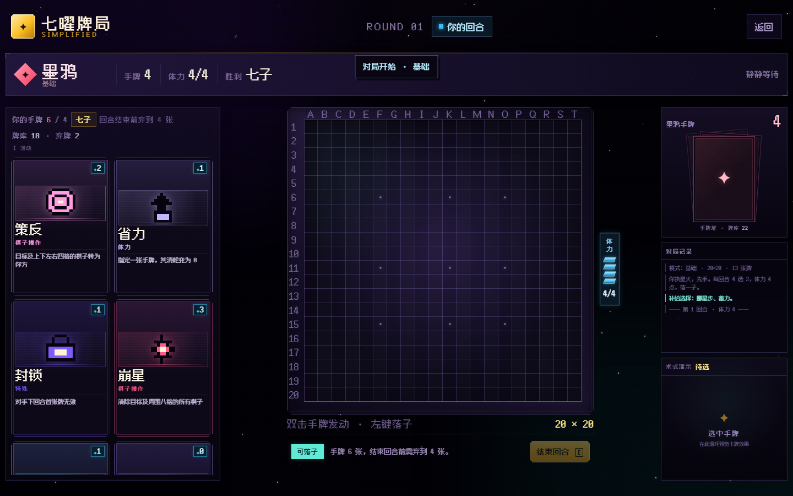

# 《七曜牌局 · 简化版》交接文档

> 版本：**简化版 v1.0.5**  
> 交付目录：`C:\Users\Chastity\Desktop\sevenflod_v1.0.5`  
> 重做依据：`C:\Users\Chastity\Downloads\棋类+卡牌游戏开发 (2).md`；新手教程与敌方反馈依据 `棋类+卡牌游戏开发 (3).md`  
> 上一版：`C:\Users\Chastity\Desktop\sevenflod_v1.0.3`（已原样保留）  
> 更早 BOSS 版：`历史版本/v1.0.1-BOSS合并版.zip`



---

## v1.0.6 收尾（2026-10-25）

接手 1.0.6 时 `node tests/engine.test.js` 有 **4 项失败**，都是「cards.js 的文案/README 已经写了新规则，`engine.js` 还是旧实现」：

| 问题 | 原实现 | 修法 |
| --- | --- | --- |
| 崩星 | 只清周围八格，中心格保留 | 中心格 + 八格一起清（`cards.js` 写的就是「目标格及其周围八格」） |
| 策反 | 只转上下左右四格 | 中心格也转 |
| 六子改胜退役 | 只清本方手牌/牌库/弃牌堆 | 新增 `retireCardEverywhere()`：清**双方**三个区域，并把移除的牌记进 `state.retiredCards`（测试按 3 张校验） |
| 补给不重复 | `takeFromDeck` 直接抽 4 张，会重复 | 新增 `takeDistinctFromDeck()`：优先抽 id 不同的牌 |

另外发现一个**改名遗留 bug**：卡牌 id 从 `winchange` 改成 `sixwin`，但 `js/ai.js` 里还残留 12 处旧 id，
导致 AI 永远不会打【六子改胜】（它的 CARD_VALUE、时机判断、手牌过滤全指向一个不存在的牌）。已全部改名。

顺手整理的工程项：

- 删除 3 个 `.DS_Store`；新增 `.gitignore`（忽略 `.DS_Store` 与三个 14MB 的整包快照 zip）。
- **音效路径规范化**：原来 `sound.js` 直接引用 `音效-分组版-mp3/01-界面/01-select 按钮 · 选牌（…）.mp3` 这种带空格和中文的长路径，
  现在 31 条音效拷到 `assets/audio/<事件名>.mp3`，`CUES` 一一对应；`23-fivewin` 随卡牌改名成 `sixwin`，源包与 `音效清单.md` 同步改名。
- README 版本号补到 v1.0.6，补了文件结构与测试命令。

---

## 一、这次重做了什么

这一版不是给旧版换皮，而是按新规则文档重新收敛：

- 保留 **20×20 / 七子连珠**（默认 7 子；六子改胜可改为 6 子）。
- 卡牌重做为 **13 张简化卡**，并在 v1.0.5 重新加入带新卡面的“六子改胜”。
- 资源从 3 点蓝条改为 **4 点体力**。
- 起手从 7 张改为 **4 张**。
- 每回合加入 **4 选 2 补给**，且**开局也立即进行 4 选 2**。
- 手牌上限改为 **4**，回合结束必须弃到 4；开局补给后手牌 6 张。
- v1.0.2 改为三栏：左侧两列手牌（内部上下滚动）、中央放大棋盘（在左右留白中居中）、右侧对手手牌堆与战报小框。
- v1.0.3 在战报下方加入 **术式演示**：选中手牌时循环播放该卡的 6.2 秒迷你效果动画。
- v1.0.5：补给改为单击选择/再次取消 + 确认；卡牌改为双击发动；图鉴恢复 13 张并带选中演示；补给四张不重复；AI 落子下落动画；教程先去闪烁、先讲胜利条件；崩星/策反包含中心格；落子状态黄/青分色。
- 体力条竖向紧贴棋盘右缘；结束回合与阶段状态放在棋盘正下方。
- 双击手牌发动；单目标牌进入选位置/选棋子状态，不再使用拖拽发动。
- 标题页保留 **基础 / 进阶 / 困难 / 基础教程**，并加回 **卡牌图鉴**。
- 背景进一步压暗；棋盘与手牌仍沿用上一版暗紫金像素视觉。
- 删除 BOSS、关卡、最终卡、暗牌、延迟秘式、拓界、窥星等旧机制。

旧 BOSS 版与旧 13×13 版均保留在 `历史版本/`，不参与当前运行。

---

## 二、快速开始

双击：

```text
index.html
```

无需构建、无需服务器。推荐 Chrome / Edge。也可：

```bash
python -m http.server 8000
```

然后访问 `http://localhost:8000`。

---

## 三、规则口径

### 3.1 基础

- 棋盘：20×20。
- 胜利：横 / 竖 / 斜 **7 子连珠**；六子改胜使用后改为 6 子。
- 双方起手各 4 张。
- 体力上限 4，每回合开始自动补满；回合结束时多余体力不带入下一回合。体力不足不能出牌。
- 每回合可以打任意张牌，但只能落一子。
- 未落子不能结束回合。
- 回合结束手牌必须 ≤4；超过时弹出弃牌面板，必须弃到 4。

### 3.2 每回合流程

1. 回合开始，体力回满 4。
2. 玩家获得 4 张**不重复**补给，单击选择/再次单击取消，选满 2 张后确认；剩下 2 张进弃牌堆。
3. 玩家可以双击手牌发动、落子；落子后仍可继续发动。
4. 结束回合；若手牌 >4，先弃牌。
5. AI 回合：AI 自动获得 2 张补给、出牌、落子、弃到 4、结束回合。

> **开局也进行 4 选 2**：起手 4 张 + 选 2 张 = 6 张，随后正常落子/出牌，结束回合前弃到 4。AI 起手 4 张，首次 AI 回合抽 2 张。

### 3.3 规则解释与设计决策

- **4 选 2**：每回合系统给 4 张不同卡种，玩家选 2 张；未选的 2 张进弃牌堆。
- **崩星/策反**：范围包含选中的中心格；崩星清除中心与周围八格，策反转化中心及上下左右四格。
- **阶段状态**：棋盘下方“可落子”青色，“已落子”黄色。
- **手牌上限**：只在回合结束时检查；回合中允许超过 4，方便补给后打牌/弃牌。
- **落子**：一回合必须落一子；卡牌不代替落子。这样保证七子棋的棋盘推进。
- **牌序**：没有即时/延时阶段，所有牌都是即时术式，落子前后都能出。
- **体力溢出**：蓄力、储能可以把体力推到 5；界面显示 5/4，属于卡牌效果。
- **最终卡 / BOSS**：本版不包含，已归档。

---

## 四、13 张卡牌

### 棋盘控制

| 卡牌 | 体力 | 实现 |
| --- | --- | --- |
| 四方封 | 1 | 指定格，封锁其上下左右四格 1 回合；目标格本身不封锁 |
| 八方封 | 2 | 指定格，封锁其周围八格 1 回合；目标格本身不封锁 |

### 棋子操作

| 卡牌 | 体力 | 实现 |
| --- | --- | --- |
| 双生星 | 2 | 指定己方星子，`doubled=true`，永久计 2 枚 |
| 挪星步 | 1 | 指定己方星子，移动到相邻八格空格 |
| 崩星 | 3 | 指定格，清除中心格及其周围八格的所有棋子 |
| 换影 | 3 | 依次选择棋盘上任意两枚棋子，交换位置 |
| 策反 | 2 | 指定格，把中心格及上下左右四格的敌方棋子转为我方；不含斜角 |

### 特殊

| 卡牌 | 体力 | 实现 |
| --- | --- | --- |
| 封锁 | 1 | 对手下回合第一张牌失效，但仍扣体力 |
| 六子改胜 | 3 | 己方胜利条件由 7 永久改为 6；成功后移出双方牌库/弃牌堆 |
| 额外抽牌 | 2 | 下回合在 4 选 2 之后额外抽 2 张 |

### 体力

| 卡牌 | 体力 | 实现 |
| --- | --- | --- |
| 蓄力 | 0 | 当前体力 +1，最高显示 5 |
| 储能 | 0 | `nextMana += 1`，下回合开始额外 1 体力 |
| 省力 | 1 | 指定另一张手牌，`discount=true`，其费用永久变 0 |

> 这些“解释”是重做时对原稿歧义处的落地口径；如果后续要调整，优先改 `cards.js` 文案与 `engine.js` 对应分支。

---

## 五、界面与交互

### 5.1 结构

- 顶部：品牌、回合、返回。
- 对手条：手牌、体力、胜利条件、状态。
- 左栏：你的手牌；两列布局，内部纵向滚动，不再横向铺满。
- 中栏：放大的 20×20 棋盘，左右背景留白一致；体力条竖向紧贴棋盘右缘。
- 中栏棋盘正下方：阶段提示、结束回合、战局提示。
- 右栏：上方对手手牌堆，中部战报，底部术式演示。
- 背景压暗为近黑深紫；棋盘/卡牌视觉语言保持上一版。
- 桌面端非标题文字 **3×**，卡牌/面板同步扩大；布局固定一屏，手牌内部滚动。
- 手机端按 2× 并改为纵向堆叠。
- 选中卡牌时，**右侧出现卡牌检视器**（牌面图、费用、描述、发动/取消），不遮挡棋盘。

### 5.2 操作

- **双击手牌**：发动卡牌。
  - 无目标牌（蓄力/储能/封锁/额外抽牌/六子改胜）：双击立即生效。
  - 有目标牌：双击进入选目标状态，再点棋盘格 / 棋子 / 手牌目标。
- 左键棋盘：落子；选中目标牌后点击目标格。
- 右键棋盘：也可落子。
- 单击手牌：选中卡牌并在右侧打开检视器；再次单击同一张取消。
- 省力等作用于手牌的卡激活后，所有可选目标手牌金色高亮并标“选择此牌”。
- 检视器“发动”：无目标牌的辅助发动方式。
- 换影：双击后点第一枚棋子，再点第二枚。
- 挪星步：双击后点己方棋子，再点相邻空格。
- 省力：双击后点另一张手牌。
- `E` 结束回合，`Esc` 取消选择，`1`–`9` 选牌。
- 未选牌时右下角显示“选中手牌”；选中后循环播放该卡 6.2 秒演示，取消/打出停止。

### 5.3 补给 / 弃牌

- 补给：4 张不重复卡种，**选 2**；开局也立即进行。
- 交互：**单击选择并高亮，再次单击同一张取消选择**；选满 2 张后点“确认选择”，与弃牌阶段一致。
- 教程补给也使用计数 + 确认按钮，不再自动完成。
- 开局：起手 4 + 补给 2 = 6 张。
- 弃牌：手牌 >4 时，结束回合会打开弃牌面板，必须选够差额。
- 两个面板都是模态，未完成不能继续。

### 5.4 新手教程

教程按 `棋类+卡牌游戏开发 (3).md` 重做为 **界面认识 + 四章引导对局**，并适配当前 4 体力 / 4 选 2 / 七子规则（六子改胜可改为 6 子）。

#### 界面认识（5 步）

1. 获胜目标：先讲七子，以及“六子改胜”改为六子；双倍/封锁/移动/转化也能改写棋局。
2. 体力条：打牌消耗；回合结束时多余的体力不会留到下一回合，但每回合开始自动补满。
3. 棋盘：20×20、七子；选择一个空格子落子，双击手牌发动。
4. 手牌：两列、牌面/费用/说明、内部滚动。
5. 结束回合：未落子不能结束、超限弃牌。

- HUD 每次只高亮一个区域；**点击任意位置或按任意键继续**。
- 提供 **继续 / 跳过说明 / 说明（重新查看）/ 重来 / 退出**。
- 高亮使用静态描边，不再闪烁。
- 重新查看说明会保留当前章节进度，看完回到原步骤。

#### 教程补给练习

- 跳过/看完说明后，先弹出 4 选 2 补给练习。
- 交互与正式对局一致：单击选择/再次取消，选满 2 张后点“确认选择”。
- 教程补给只显示标题、卡牌、计数与确认按钮；练习不改变第 1 章固定手牌。

#### 引导对局（4 章）

| 章节 | 教学内容 | 关键操作 |
| --- | --- | --- |
| 1 体力与封锁 | 体力限制、封锁格 | 四方封 H10 → 落子 G11 → 结束 |
| 2 移动与双倍 | 移动改变位置、双倍计数 | 挪星步 F11→G11 → 双生星 → 落子 I11 → 结束 |
| 3 封锁与补给 | 封锁对手首牌、额外抽牌 | 封锁 → 额外抽牌 → 落子 J11 → 结束 |
| 4 六子改胜 | 7 子目标改为 6 子并完成 | 双击六子改胜 → 落子 G11 完成六连 |

- 每章使用固定牌序/固定棋局，错误牌或目标会提示并高亮正确目标，不判负。
- 章节之间由固定敌方行动衔接；教程不计入战绩。
- 教程结果统计累计施术数与章节数。

### 5.5 敌方回合反馈

- AI 每一步通过 `onAction` 回报：回合开始抽牌、发动卡牌、落子、弃牌、结束回合。
- 右侧出现 **墨鸦行动面板**：卡牌像素图、名称、费用、剩余体力、效果说明。
- 棋盘受影响格显示金/红/紫脉冲高亮：
  - 崩星：红色危险格；
  - 封锁：紫色封禁格；
  - 策反/双生/移动/交换：金色效果格；
  - 落子：金色落点高亮。
- 每条反馈固定停留 **2 秒**，再继续 AI 下一步；敌方动画与全屏防闪互不冲突。
- AI 落子额外播放 **560ms 下落动画**（`.is-ai-drop`），只影响新落星子。
- 教程的固定敌方行动复用同一面板与高亮。

### 5.6 右下角术式演示

- 位置：右侧对局记录下方、原空白区域；面板 `#fxShowcase`。
- 触发：选中手牌且尚未打出时循环播放；取消选择、打出、AI 回合或回到待选时停止并显示“选中手牌”提示。
- 时长：每张卡动画统一 **6.2 秒**，CSS `infinite` 无缝循环；同一张牌持续选中不重建 DOM。
- 场景：
  - 棋盘类用 7×7 迷你棋盘，目标格、棋子、封锁、爆炸、交换、转化均按实际效果绘制；
  - 资源/手牌类用卡背、牌堆、体力格、费用卡示意。
- 13 张卡分别有独立动画：四方封、八方封、双生星、挪星步、崩星、换影、策反、封锁、六子改胜、额外抽牌、蓄力、储能、省力。
- 崩星/策反动画同步包含中心格。
- 面板头部显示卡名与“循环”标记；底部显示一句效果说明。

### 5.7 卡牌图鉴（13 张）

- 首页按钮“卡牌图鉴 13”；模态标题“卡牌图鉴 · 13”。
- 顶部为选中卡牌的循环演示，复用 `CARD_FX` 与 6.2 秒动画；点击下方任意卡牌切换。
- 默认选中新卡“六子改胜”，直接展示其 6 子胜利与 7→6 标记动画。
- 网格 13 张卡（四列，手机两列），卡牌可点击并有金色选中态。


---

## 六、代码结构

```text
sevenflod_v1.0.5/
├─ index.html
├─ styles.css
├─ README.md
├─ 交接文档.md
├─ 设计原稿-简化版.md
├─ 设计原稿-教程与反馈.md
├─ 设计原稿-棋类卡牌游戏开发.md
├─ js/
│  ├─ cards.js       13 张卡数据、费用、10×10 像素牌面
│  ├─ engine.js      简化规则引擎、补给不重复
│  ├─ ai.js          基础/进阶/困难 AI
│  └─ ui.js          双击发动、补给/弃牌、图鉴演示、教程、术式演示
├─ assets/
│  ├─ fusion-pixel.woff2
│  ├─ FUSION-PIXEL-LICENSE.txt
│  ├─ favicon.svg
│  ├─ preview-title.png
│  ├─ preview-game.png
│  ├─ preview-tutorial.png
│  ├─ preview-supply.png
│  ├─ preview-showcase.png
│  └─ preview-codex.png
├─ tests/
│  ├─ engine.test.js
│  └─ ai.test.js
└─ 历史版本/
   ├─ README.md
   ├─ sevenfold-main-旧版/
   └─ v1.0.1-BOSS合并版.zip
```

### 6.1 `cards.js`

- 13 张卡，`cost` 0–3；六子改胜使用独立像素卡面。
- `target`：`cell` / `stoneOwn` / `moveOwn` / `swap` / `handCard` / `none`。
- 每张卡带一个 `icon`：10×10 的 0–5 像素图数组，沿用上上个版本的像素图标语言。
- `ui.js` 的 `renderIcon()` 把像素数组渲染成 SVG；手牌、补给、弃牌、检视器、标题浮动卡共用。
- `glyph` 只保留为文字兜底，不再作为主牌面。

### 6.2 `engine.js`

主要状态：

- `size / cells / current / status / round / ply`
- `placed`：本回合是否落子
- `players.*.hand / deck / discard / mana / maxMana / winTarget / silenced / nextMana / extraDraw`
- `offer`：当前 4 张补给；由 `takeUniqueFromDeck()` 保证卡种不重复
- `seals`：封锁格 -> 到期 ply
- `stats`

主要方法：

| 方法 | 说明 |
| --- | --- |
| `startTurn(side)` | 回体力、发补给 / AI 抽 2；开局也会进入补给 |
| `startDraft()` / `chooseOffer(indices)` | 玩家 4 张不重复补给，选 2 |
| `canPlayCard()` / `playCard()` | 体力、目标、全部 13 张效果 |
| `place()` / `canPlace()` | 一回合落一子 |
| `discard(side, uids)` | 弃到上限 |
| `endTurn(side)` | 校验落子与手牌，切换回合 |
| `findWin()` / `resolveWins()` | 七子 / 六子判定 |
| `getCardTargets()` / `getMoveDestinations()` | UI 高亮 |

主要事件：`turnStart`、`offer`、`draftChosen`、`manaRefilled`、`cardPlayed`、`sealed`、`twinApplied`、`stoneMoved`、`detonated`、`swapped`、`subverted`、`silenced`、`winTargetChanged`、`extraDrawQueued`、`manaGained`、`manaStored`、`discountApplied`、`handDiscarded`、`gameOver`。

### 6.3 `ai.js`

- 三档：easy / normal / hard。
- 会寻找双生星 / 策反 / 挪星步的直接胜利。
- 会尝试用封锁 / 崩星阻止玩家下一手成六。
- 会出牌、落子、弃到 4、结束回合。
- 通过 `takeTurn({ onAction })` 在抽牌/出牌/落子/弃牌/结束处暂停，供 UI 播放敌方反馈。
- 只读取公开棋盘与自己手牌。

### 6.4 `ui.js`

- 四模式入口：3 难度 + 基础教程；首页另有卡牌图鉴按钮。
- v1.0.2 三栏：左栏手牌、中栏棋盘、右栏对手手牌堆 + 战报。
- v1.0.3 在右栏战报下方新增 `#fxShowcase` 术式演示；`CARD_FX` 描述 13 张卡的迷你场景。
- 双击手牌发动；无目标牌立即生效，有目标牌进入选目标状态。
- 卡牌图鉴顶部复用 `CARD_FX`，点卡切换，默认展示六子改胜；图鉴共 13 张。
- 补给面板与弃牌一致：单击选择/再次取消、计数、确认；补给四张不重复。
- 棋盘下方阶段状态：可落子青色 `.is-open`，已落子黄色 `.is-placed`。
- AI 落子通过 `.is-ai-drop` 播放 560ms 下落动画。
- 补给面板、弃牌面板、结果面板、教程 HUD、卡牌检视器。
- 卡牌检视器：选中时固定右侧（棋盘外），显示像素牌面、费用、类型、描述和“发动/取消”；悬停时只显示信息。
- AI 回合通过 `is-ai-turn` 关闭石块/卡牌/棋盘动画，并跳过玩家手牌重复渲染，避免屏幕闪烁。
- 右栏牌堆显示墨鸦手牌张数（`aiRailCount`）与牌库数；下方小战报框显示最近记录。
- 术式演示：`showCardShowcase()` / `hideCardShowcase()` / `syncCardShowcase()`；选中变化时切换，取消/打出时回到待选。
- 深紫 / 金色主题的 DOM 渲染与交互。
- 敌方反馈：`showEnemyAction()`、`highlightEnemyEffect()`、`markEnemyCells()`、`.enemy-action` 面板。
- 教程状态机：
  - `TUTORIAL_INTRO`：5 个界面说明步骤，首步为获胜目标；高亮静态无闪烁；
  - `TUTORIAL_CHAPTERS`：seal / move / control / final 四章；
  - `tutorialStep()` / `tutorialFocus()` / `tutorialRequiredCard()`；
  - `tutorialNext()` / `skipTutorialIntro()` / `finishTutorialIntro()`；
  - `onTutorialBoardClick()` / `runTutorialAI()` / `nextTutorialChapter()`；
  - `showTutorialResult()`。

### 6.5 `styles.css`

- 深紫 / 金色 / 青色 / 珊瑚红为主，沿用上一版美术风格，背景进一步压暗。
- 深色棋盘 + 金色角线 + 暗色像素卡牌。
- 三栏布局：左栏手牌两列、中央棋盘放大居中、右栏牌堆 + 战报 + 术式演示。
- 棋盘右侧竖向体力条；结束回合在棋盘正下方；阶段状态黄/青分色。
- 图鉴演示区、卡牌 selected 态、AI 落子 `aiStoneDrop` 动画。
- 桌面固定一屏、手牌内部滚动；手机纵向堆叠。
- 术式演示：7×7 迷你棋盘、`.fx-*` 组件、统一 `--fx-dur: 6.2s` 的 keyframes；右栏弹性填充，手机固定约 220px。

---

## 七、测试与验收

### 7.1 运行

```bash
node tests/engine.test.js
node tests/ai.test.js
```

当前：

- 引擎：**17 通过，0 失败**
- AI：**4 通过，0 失败**

覆盖：

- 20×20、起手 4、体力 4、七子/六子胜利；
- 双生星、四方封、八方封；
- 挪星步、崩星（含中心）、换影、策反（含中心）；
- 封锁、六子改胜及退役、额外抽牌、储能、蓄力 / 省力；
- 开局 4 选 2、补给四张不重复、弃牌、未落子不能结束回合。

### 7.2 浏览器验收

已完成：

- 1440×900：三栏固定一屏；左栏 6 张手牌两列、内部滚动；中央棋盘放大且左右留白一致；右栏牌堆/战报；结束回合在棋盘正下方；
- 棋盘右侧竖向体力条，4 个体力格正常显示；
- 390×844：2×、纵向堆叠；手牌两列、内部纵向滚动；棋盘与右栏顺序不溢出；
- 13 张牌面均有 10×10 像素图，六子改胜有独立新卡面；
- 首页“卡牌图鉴”打开 13 张图鉴，点击卡牌切换顶部循环演示；
- 双击无目标牌立即发动；双击目标牌进入选目标状态；
- 省力激活后，3 张可选目标手牌金色高亮并标“选择此牌”；
- 点击卡牌 → 右侧检视器 → “发动”/“取消”备用流程可用；检视器不遮挡棋盘；
- 换影费用 3；六子改胜重新加入（13 张），使用后胜利条件变 6 并移出牌库；
- 补给四张不重复；单击选择/再次取消，选满后确认；不再自动完成；
- 教程补给使用同一计数 + 确认按钮；
- AI 回合 `is-ai-turn`、常规石块动画 none、玩家手牌不重复渲染；AI 落子单独 560ms 下落；
- 开局 4 选 2 → 起手 6 张；补给 4 选 2；
- 教程 5 步界面说明 + 补给练习 + 4 章引导对局完整通关（17 引擎测试 + 浏览器实际点击）；
- 教程第 1 步为获胜目标；高亮静态无闪烁；说明支持任意点击/任意键继续；
- 棋盘下方“可落子”青色、“已落子”黄色；
- 崩星/策反包含中心格的引擎测试与演示动画通过；
- 普通 AI 回合逐条出现抽牌/卡牌/落子/弃牌/结束反馈，每条固定 2 秒，受影响格有停留高亮；
- 棋盘顶部 A–T 字母栏完整显示；
- 右栏战报下方术式演示；未选牌为“选中手牌”提示；
- 选中 13 张卡逐一验证演示场景、卡名与循环标记；动画 6.2 秒、`infinite`；
- 持续选中 7 秒仍在循环；取消/打出后恢复待选；检视器与演示区不重叠；
- 卡牌图鉴 13 张，点击卡牌切换顶部演示；
- AI 回合无全屏闪烁、无控制台错误；
- AI 完整对局可结束；
- 无控制台错误；
- 本地字体加载正常。

---

## 八、已知限制

- 本版是**单机 Demo**，没有联网、账号、排位、剧情。
- 没有音效 / BGM（重做时优先规则与视觉）。
- 没有悔棋、存档、回放。
- 标题页保留 4 个模式入口，并新增“卡牌图鉴”按钮；图鉴在模态中展示 13 张牌并带选中演示。
- 规则主要靠 README、卡牌检视器与图鉴。
- 桌面 1440×900 采用固定一屏三栏；手牌超过两行时靠左栏内部纵向滚动，不再撑高页面。
- 手机端使用 2× 并纵向堆叠；手牌两列、内部滚动，右栏牌堆/战报在下方。
- 拖拽依赖桌面 HTML5 drag & drop；触屏以点击选牌作为回退。
- 卡牌没有暗牌 / 隐藏信息；AI 不做隐藏信息推理。
- 教程为 5 步界面说明 + 补给练习 + 4 章固定引导对局，不含完整自由对局教学内容。
- “4 选 2”按每回合处理，**开局也执行**；如果后续想改成“每局只选一次”或“补给替换手牌”，需要调整 `startTurn` / `chooseOffer` 与 UI。
- 崩星/策反均包含目标中心格；策反仍不转化斜角，这是当前口径。
- 体力可被蓄力/储能推到 5，界面显示 5/4；这是有意保留的“溢出”表现。

---

## 九、下一阶段建议

1. **玩法**：增加“补给替换手牌”或“4 选 2 只在前几回合”等变体，观察节奏。
2. **卡牌**：13 张已有 10×10 像素图；后续可继续细化“封锁/省力”等抽象图标。
3. **AI**：把“崩星/换影/省力”的主动组合做得更深；当前 AI 偏直接。
4. **教程**：继续补充高费牌不可用演示、失败分支与更多组合关卡；当前为 5 步说明 + 补给练习 + 4 章固定引导。
5. **视觉**：继续参考图片加入角色立绘、STAGE 过场、手势引导；当前只保留棋盘/卡牌主界面。
6. **工程**：若继续扩卡，建议把 `playCard` 的 switch 拆成卡牌 effect 表，避免单文件膨胀。

---

## 十、交付清单

- [x] `index.html`：四模式 + 卡牌图鉴、三栏对局、补给/弃牌、结果
- [x] `styles.css`：暗场、深紫 / 金色主题、非标题 3×、响应式
- [x] `js/cards.js`：13 张简化卡 + 10×10 像素牌面
- [x] `js/engine.js`：4 体力 / 4 选 2（开局也进行）/ 弃牌 / 7 连（六子改胜可改为 6）
- [x] `js/ai.js`：三档 AI
- [x] `js/ui.js`：双击发动、检视器、13 张卡牌图鉴与选中演示、AI 落子动画、交互与基础教程
- [x] `assets/`：字体、许可证、预览图
- [x] `tests/engine.test.js`：17 项通过
- [x] `tests/ai.test.js`：4 项通过
- [x] `README.md`：玩家向说明
- [x] `交接文档.md`：本文件
- [x] `历史版本/`：旧 13×13 版与 v1.0.1 BOSS 版 zip

---

## 十一、接手检查建议

1. 双击 `index.html`，确认标题有 **基础 / 进阶 / 困难 / 基础教程** 与「卡牌图鉴 13」。
2. 开始「基础」：
   - 20×20、起手 4、体力 4/4；
   - **立即弹出 4 选 2**，四张不重复；单击选择/再次取消，选满后确认；
   - 左栏手牌两列、内部上下滚动；牌面为 10×10 像素图；
   - 双击无目标牌应立即发动；双击崩星应进入选目标；
   - 棋盘右侧竖向体力条；结束回合在棋盘正下方；“可落子”青色、“已落子”黄色。
3. 结束回合后观察 AI；AI 落子有下落动画；每条反馈停留 2 秒。
4. 补给后手牌 6，落子并结束，确认弃牌面板必须弃 2。
5. 打开「基础教程」：第 1 步应为获胜目标；补给需确认；关键牌双击发动。
6. 首页点「卡牌图鉴 13」：默认六子改胜演示，点击任意卡牌切换顶部动画。
7. 运行两个测试文件，确认 17 + 4 通过。
8. 手机尺寸打开，确认棋盘、手牌、体力条不溢出；标题四按钮两列布局正常。

---

## 十二、归档说明

上一版 v1.0.3 完整目录原样保留在：

```text
C:\Users\Chastity\Desktop\sevenflod_v1.0.3
```

更早的 v1.0.1 3× 单栏简化版也原样保留：

```text
C:\Users\Chastity\Desktop\sevenflod_v1.0.1
```

更早的 20×20 + 蓝条 + 教程 + BOSS 合并版保存在：

```text
历史版本/v1.0.1-BOSS合并版.zip
```

旧 13×13 / 七子 / 单牌 BOSS 版完整快照保存在：

```text
历史版本/sevenfold-main-旧版/
```

根目录当前运行的是**简化版**，不要用旧 `tools/arena.js` 或旧 `levels.js` 直接跑新引擎。

---

**交接结论：** v1.0.5 完成补给确认、双击发动、13 张图鉴与选中演示、补给不重复、AI 落子动画、教程去闪烁并先讲胜利条件、崩星/策反含中心、落子状态黄/青分色；右栏术式演示仍为 13 张卡各 6.2 秒循环。v1.0.3 原样保留；旧 BOSS 版与旧 13×13 版可追溯。
